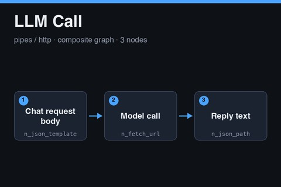

# LLM Call

<a href="llm-call.subfork.json" download="llm-call.subfork.json" aria-label="Download graph" title="Download graph"><svg xmlns="http://www.w3.org/2000/svg" width="16" height="16" viewBox="0 0 24 24" fill="none" stroke="currentColor" stroke-width="2" stroke-linecap="round" stroke-linejoin="round" aria-hidden="true"><path d="M12 3v12m-5-5 5 5 5-5M5 16v5h14v-5"/></svg></a>

A reusable synchronous chat-completion call built from generic nodes. It builds an
OpenAI-style chat request body from a prompt, a system message, and a model name,
POSTs it to a URL the caller supplies, and extracts the reply text from the
response. It is provider-neutral: any endpoint that accepts that request shape and
returns the reply at a known path works. Import it independently, or publish it as
a composite and call it from a parent graph as a single node.

The graph references no secrets, environment-specific graph IDs, or generated
media.

## Data flow

1. **Chat request body** (`n_json_template`) builds `model` plus a `messages` array
   with one `system` and one `user` message.
2. **Model call** (`n_fetch_url`) POSTs the body to `url` with the `headers` input.
   The request has a 60-second timeout. The response-size limit is the node default
   and is not overridden here.
3. **Reply text** (`n_json_path`) reads `reply_path` from the JSON response.

## Inputs and outputs

| Input | Type | Meaning |
| --- | --- | --- |
| `url` | `url` | Required chat endpoint. Receives the `headers` value, so see the security notes |
| `headers` | `json` | Required request headers, built by the parent graph (see Authentication) |
| `prompt` | `str` | Required user message |
| `system` | `str` | Required system message |
| `model` | `str` | Required model name the endpoint understands |
| `reply_path` | `str` | Optional path to the reply text; defaults to `choices.0.message.content` |

| Output | Type | Meaning |
| --- | --- | --- |
| `reply` | `json` | The value found at `reply_path` |
| `response` | `json` | The full JSON response from the endpoint |
| `status` | `int` | HTTP status code |

Change `reply_path` for providers that return the text elsewhere. The `response`
output is there for inspection when the path does not match.

## Authentication

The graph never holds a credential. The parent graph owns the secret and passes
request headers in through the `headers` input:

1. In the parent, add a JSON Template node with the template
   `{"Authorization": "Bearer {{ secrets.LLM_API_KEY }}", "Content-Type": "application/json"}`.
2. Connect its `value` output to this graph's `headers` input.
3. Add the secret `LLM_API_KEY` in the parent graph's **Graph Settings → Execution
   Profile**. Never paste a key into a graph, a fixture, or these notes.

Use whatever header names and secret name your endpoint requires. Whether node
outputs and execution logs redact header values has not been verified, so do the
first run with a throwaway key and inspect the logs before using a real one.

## Security guidance

- **Use a literal URL in the parent graph.** The `url` input receives the headers,
  including the bearer token. Do not feed it from request data, model output, or
  any other untrusted value, or the token is sent to whatever host that value
  names. Pin it to the provider origin you intend.
- **Use a low-privilege key.** Prefer a key scoped to this one use, with a spending
  limit where the provider offers one.
- **The prompt leaves your instance.** Every run sends the prompt and system
  message to the endpoint. Do not pass data you are not allowed to share with that
  provider.

## Cost and limits

Each run makes one POST that can be billed by the provider. The graph does not
retry. If a run ends with an unknown outcome, check the provider before running it
again, because a second run can be billed again. Provider rate limits, context
limits, and terms apply.

## Using it as a composite

Publish the graph and call it from a parent that supplies `url` and `headers` as
literals or from its own secrets, and passes `prompt`, `system`, and `model` from
upstream nodes. Pin the published version when the parent depends on its behavior,
and record which version the parent was tested with.

## Validation status

The graph passes the repository validator and the production node-catalog check.
It has not been freshly imported and executed against a live provider, and no
provider request was made while adding it. Catalog validation is not evidence of
provider execution. Whether placeholders nested inside the array and object of the
request template resolve as intended has not been confirmed in a live run. The
Subfork version used for a manual test is not recorded because no manual test was
run.
