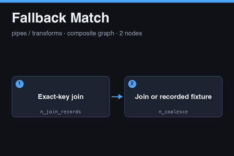

# Fallback Match

<a href="fallback-match.subfork.json" download="fallback-match.subfork.json" aria-label="Download graph" title="Download graph"><svg xmlns="http://www.w3.org/2000/svg" width="16" height="16" viewBox="0 0 24 24" fill="none" stroke="currentColor" stroke-width="2" stroke-linecap="round" stroke-linejoin="round" aria-hidden="true"><path d="M12 3v12m-5-5 5 5 5-5M5 16v5h14v-5"/></svg></a>

A reusable exact-key join that returns a recorded fixture when the join finds nothing.
It left-joins two lists of records on a key, and falls back to a value the caller
supplies when the result is empty. Use it for a library or feed lookup that should still
produce something predictable when the live data has no match. Import it independently,
or publish it as a composite.

Matching is exact on the key values. Tolerance or fuzzy joins are not covered. The graph
is local JSON processing: it makes no network requests, needs no credentials, and has no
side effects.

## Data flow

1. **Exact-key join** (`n_join_records`) left-joins `left` and `right` on `left_key` and
   `right_key`. Both keys default to `id`.
2. **Join or recorded fixture** (`n_coalesce`) returns the join result, or `fixture` when
   the join yields nothing.

## Inputs and outputs

| Input | Type | Meaning |
| --- | --- | --- |
| `left` | `json` | Required list of records that drive the result |
| `right` | `json` | Required list of records to look up |
| `fixture` | `json` | Required fallback value returned when the join is empty |
| `left_key` | `str` | Optional field name in `left`; defaults to `id` |
| `right_key` | `str` | Optional field name in `right`; defaults to `id` |

| Output | Type | Meaning |
| --- | --- | --- |
| `items` | `json` | The joined records, or the fixture |

Because the join is a left join, every `left` record appears in the result even without
a match. Whether the fallback node treats an empty list as empty, and so returns the
fixture, has not been confirmed. Run the graph once with a `left` list that has records
and a `right` list that has none, and with an empty `left` list, and check which the
output contains before depending on the fallback.

## Authentication and security

There is nothing to wire. The graph holds no credentials and calls no service. The
fixture is returned as given, so keep real data and secrets out of it if the output is
displayed or sent onward.

## Using it as a composite

Publish the graph and call it from a parent that fetches `left` and `right` upstream and
passes a small recorded `fixture` shaped like the real result. Connect `items` to the
next transform or a table or JSON panel.

## Validation status

The graph passes the repository validator and the production node-catalog check. It has
not been freshly imported and executed. The empty-result behavior above is unverified.
The Subfork version used for a manual test is not recorded because no manual test was
run.
